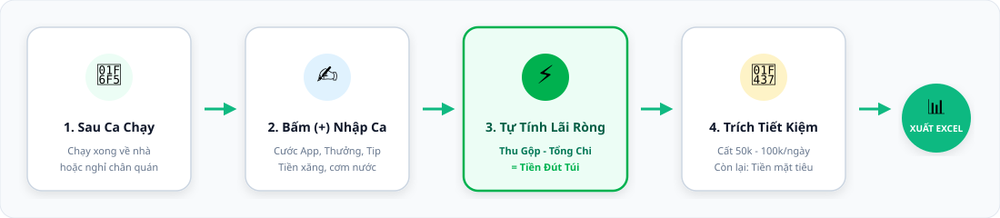
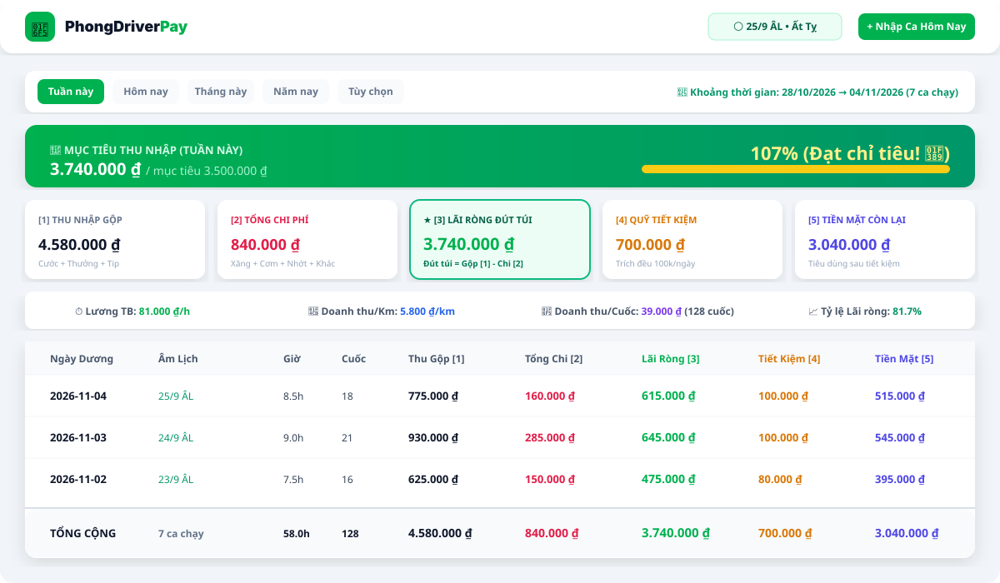
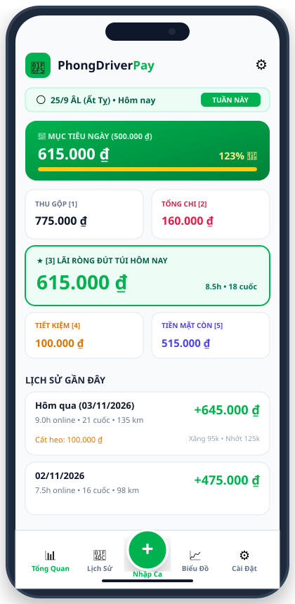

<p align="center">
  
</p>

# 🛵 PhongDriver Pay - Quản Lý Doanh Thu & Tiết Kiệm Chạy Grab

> **Ứng dụng Web Single Page Application (SPA) & Progressive Web App (PWA) hoàn chỉnh, responsive mượt mà trên cả Điện thoại (Mobile-First) và Máy tính (Desktop).**  
> Dành riêng cho các Bác tài Grab (GrabBike, GrabCar, GrabFood) để theo dõi doanh thu thực, chi phí vận hành, trích quỹ tiết kiệm hàng ngày và tính lương thực nhận đút túi.

---

## 🌐 Đường Link Dùng Trực Tiếp (GitHub Pages Miễn Phí)
👉 **Truy cập ngay:** [https://nguyentanphong-12022k5.github.io/PhongDriver_Pay/](https://nguyentanphong-12022k5.github.io/PhongDriver_Pay/)

---

## 🔄 Quy Trình Sử Dụng Hàng Ngày Của Bác Tài

<p align="center">
  
</p>

1. **Sau ca chạy**: Bác tài về nhà hoặc dừng chân uống nước, mở ứng dụng trên điện thoại.
2. **Bấm nút (+) Nhập Ca**: Điền số giờ chạy, số cuốc, tiền cước trên app Grab, tiền thưởng ngọc và tiền tip.
3. **Nhập chi phí**: Tiền đổ xăng, tiền ăn uống cà phê, tiền thay nhớt / sửa xe (nếu có).
4. **Hệ thống tự động tính toán**: Tính ngay số tiền lãi ròng thực nhận đút túi hôm nay.
5. **Trích quỹ tiết kiệm**: Chọn cất riêng 50.000đ - 100.000đ vào heo đất trước khi tiêu tiền mặt.
6. **Báo cáo & Xuất Excel**: Xem lại biểu đồ thống kê xu hướng hoặc xuất file Excel để kiểm tra theo tuần/tháng.

---

## 📸 Giao Diện Ứng Dụng

### 🖥️ 1. Giao Diện Máy Tính (Desktop Dashboard)
Bố cục dạng Dashboard toàn cảnh, bảng dữ liệu chi tiết, các thẻ KPI trực quan và biểu đồ xu hướng.

<p align="center">
  
</p>

---

### 📱 2. Giao Diện Điện Thoại (Mobile-First)
Thiết kế tối ưu cho ngón tay cái, nút bấm to dễ thao tác bằng một tay khi đang chạy xe ngoài đường, thanh điều hướng cố định dưới đáy màn hình.

<p align="center">
  
</p>

---

## 📱 Hướng Dẫn Cài Đặt Vào Điện Thoại (PWA - Dùng Như App Thật)

Ứng dụng hỗ trợ công nghệ **PWA (Progressive Web App)**, không cần qua App Store hay CH Play, bạn có thể đưa ra màn hình chính của điện thoại chỉ trong 10 giây:

### 👉 Trên iPhone (Trình duyệt Safari):
1. Dùng **Safari** mở đường link: `https://nguyentanphong-12022k5.github.io/PhongDriver_Pay/`
2. Bấm vào nút **Chia sẻ** (biểu tượng hình vuông có mũi tên chỉ lên ở thanh dưới cùng).
3. Cuộn xuống và chọn **"Thêm vào MH chính" (Add to Home Screen)**.
4. Bấm **Thêm** ở góc trên bên phải.  
   *(Biểu tượng xe máy 🛵 **PhongDriver** sẽ xuất hiện trên màn hình iPhone, mở lên toàn màn hình không có thanh web).*

### 👉 Trên Android (Trình duyệt Chrome):
1. Dùng **Google Chrome** mở đường link web.
2. Bấm vào **dấu 3 chấm (⋮)** ở góc trên bên phải màn hình.
3. Chọn **"Cài đặt ứng dụng"** (hoặc **"Thêm vào màn hình chính"**).
4. Xác nhận Cài đặt.

---

## 🧮 Logic Tính Toán & 5 Chỉ Số Cốt Lõi

```
┌────────────────────────────────────────────────────────────────────────┐
│ [1] TỔNG THU NHẬP GỘP = Cước App + Thưởng (Ngọc, Mốc) + Tiền Tip       │
│ [2] TỔNG CHI PHÍ      = Xăng xe + Ăn uống + Bảo dưỡng + Chi đột xuất   │
│ [3] THU NHẬP RÒNG     = [1] Thu nhập gộp - [2] Tổng chi phí (ĐÚT TÚI)  │
│ [4] QUỸ TIẾT KIỆM     = Số tiền trích cất riêng vào heo đất hôm đó     │
│ [5] TIỀN MẶT CÒN LẠI  = [3] Thu nhập ròng - [4] Quỹ tiết kiệm          │
└────────────────────────────────────────────────────────────────────────┘
```

### Các chỉ số hiệu suất dành riêng cho Bác tài:
- **Lương trung bình / Giờ**: `Thu nhập ròng / Số giờ chạy` (giúp bạn biết mỗi giờ chạy xe kiếm được bao nhiêu tiền thực nhận).
- **Doanh thu / Km**: `Doanh thu / Số Km` (đánh giá hiệu quả cung đường chạy).
- **Chi phí vận hành / Km**: `Tổng chi phí / Số Km` (giúp theo dõi mức độ hao xăng và hao mòn xe).
- **Doanh thu / Cuốc xe**: `Doanh thu / Số cuốc đã nhận`.
- **Tỷ suất lợi nhuận ròng (%)**: `(Thu nhập ròng / Tổng doanh thu) x 100%`.
- **Thanh tiến độ Mục tiêu ngày**: Đặt mục tiêu thu nhập (ví dụ: 500.000đ/ngày), tự động bắn pháo hoa 🎉 chúc mừng khi đạt 100%!

---

## 🌕 Tích Hợp Lịch Dương & Lịch Âm Việt Nam (UTC+7)

- Tích hợp thuật toán thiên văn Âm lịch Việt Nam chuẩn múi giờ UTC+7 của TS. Hồ Ngọc Đức.
- Hiển thị ngày Âm lịch, Can Chi ngày, tháng, năm (ví dụ: *Ngày 25 tháng 9 năm Giáp Thìn*).
- Tự động đánh dấu và nhắc nhở ngày đặc biệt:
  - **Mùng 1 (Sóc - Đầu tháng)**.
  - **Hôm Rằm (Vọng - Ngày 15 ÂL)**.
  - Các ngày Tết truyền thống & Quốc lễ: *Tết Nguyên Đán (30 Tết, Mùng 1 - 3), Giỗ Tổ Hùng Vương (10/3 ÂL), Đại Lễ Phật Đản, Tết Đoan Ngọ (5/5 ÂL), Vu Lan Báo Hiếu (15/7 ÂL), Tết Trung Thu, Tiễn Táo Quân (23 tháng Chạp), Giải phóng miền Nam 30/4, Quốc tế Lao động 1/5, Quốc khánh 2/9...*
- Bộ lọc thời gian linh hoạt: **Hôm nay**, **Hôm qua**, **Tuần này**, **Tháng này**, **Năm nay**, **Tất cả**, hoặc **Tùy chọn khoảng ngày**.

---

## 📊 Hướng Dẫn Xuất & Nhập Báo Cáo Excel

### 1. Xuất báo cáo Excel (.xlsx):
- Bấm nút **"Xuất Excel"** ở góc phải bảng lịch sử hoặc trong menu **Cài đặt**.
- File tải về có tên dạng: `Bao_Cao_Thu_Nhap_Grab_2026-11-04.xlsx`.
- Bảng tính được định dạng chuẩn: có dấu tiếng Việt, phân cột rõ ràng, định dạng tiền tệ và có hàng **TỔNG CỘNG / TRUNG BÌNH** ở dòng cuối.

### 2. Sao lưu và Khôi phục dữ liệu:
- **Tự động lưu**: Dữ liệu lưu trực tiếp trong trình duyệt điện thoại (`LocalStorage`), mở lại hoặc F5 không bao giờ mất.
- **Khi đổi điện thoại mới**:
  1. Trên máy cũ: Vào **Cài đặt** $\rightarrow$ Bấm **"Xuất Sao Lưu (JSON)"** $\rightarrow$ gửi file này qua Zalo/Drive.
  2. Trên máy mới: Vào **Cài đặt** $\rightarrow$ Bấm **"Nhập Dữ Liệu Từ File"** $\rightarrow$ chọn file vừa gửi để khôi phục toàn bộ lịch sử!

---

## 🛠️ Hướng Dẫn Kích Hoạt GitHub Pages (Để Có Link Web)

Nếu trên GitHub của bạn trang web chưa hiển thị, hãy làm theo 3 bước sau:

1. Vào trang GitHub của bạn: `https://github.com/nguyentanphong-12022k5/PhongDriver_Pay`
2. Bấm vào tab **Settings** (hình bánh răng cưa ở trên).
3. Ở menu bên trái, bấm vào mục **Pages**.
4. Tại mục **Build and deployment** $\rightarrow$ ở ô **Source**, chọn:  
   👉 **GitHub Actions**
5. Chờ khoảng 1 phút, GitHub Actions sẽ tự động biên dịch và hiển thị link xanh:  
   `https://nguyentanphong-12022k5.github.io/PhongDriver_Pay/`

---

## 💻 Dành Cho Lập Trình Viên (Cài Đặt & Chạy Cục Bộ)

```bash
# 1. Clone repository về máy tính
git clone https://github.com/nguyentanphong-12022k5/PhongDriver_Pay.git

# 2. Di chuyển vào thư mục dự án
cd PhongDriver_Pay

# 3. Cài đặt các thư viện cần thiết
npm install

# 4. Khởi chạy ở môi trường phát triển (Local dev server)
npm run dev

# 5. Đóng gói sản phẩm (Production build)
npm run build
```

---

*Chúc các Bác tài vạn dặm bình an, nổ cuốc đều tay, gom đầy tiết kiệm! 🛵💨*
